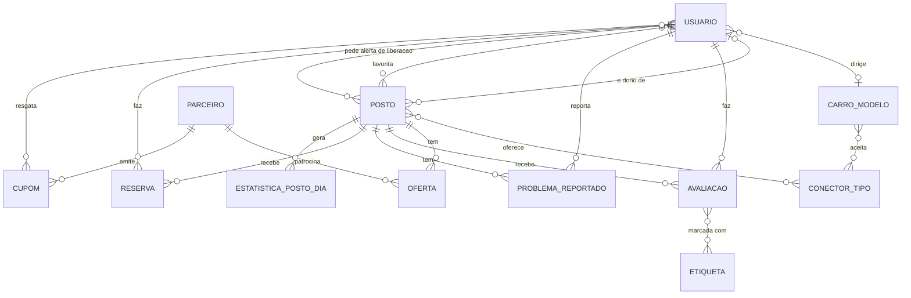

# Diagrama Conceitual (DER) do MAPERE

Mostra só as entidades e como elas se relacionam, sem colunas. O diagrama abaixo aparece desenhado direto no GitHub.

## Entidades

| Entidade | O que representa |
|---|---|
| USUARIO | Motorista ou dono de posto (visitante não tem cadastro) |
| CARRO_MODELO | Modelo de carro elétrico usado no filtro "Meu carro" |
| CONECTOR_TIPO | Tipo de plugue: CCS2, Type 2, CHAdeMO, GB/T, Outro |
| POSTO | Eletroposto de Aracaju, com status, vagas, potência e preço |
| PARCEIRO | Comércio que dá benefícios (café, lavagem, cinema) |
| OFERTA | Benefício de um parceiro exibido em um posto |
| CUPOM | Vantagem que o motorista troca por pontos |
| AVALIACAO | Check-in com status, nota, foto e comentário |
| ETIQUETA | Marcador da avaliação ("Preço justo", "Costuma ter fila"...) |
| PROBLEMA_REPORTADO | Aviso de defeito (+15 pontos) |
| RESERVA | Bloqueio de vaga por 15, 30 ou 45 minutos |
| ESTATISTICA_POSTO_DIA | Indicadores do painel do dono |

## Cardinalidades (resumo)

- Um posto tem vários plugues e um plugue existe em vários postos (N:N).
- Um usuário avalia vários postos e um posto recebe várias avaliações (1:N dos dois lados, com a avaliação como entidade).
- Favoritos, alertas de liberação e resgates de cupom são relações N:N entre usuário e posto (ou cupom).
- Um posto pode ter no máximo um dono, e um dono pode ter vários postos.

> **Para entregar à professora:** refaça este diagrama no BRModelo (modelo conceitual), tire o print e salve nesta pasta. O arquivo `.md` serve de guia.
