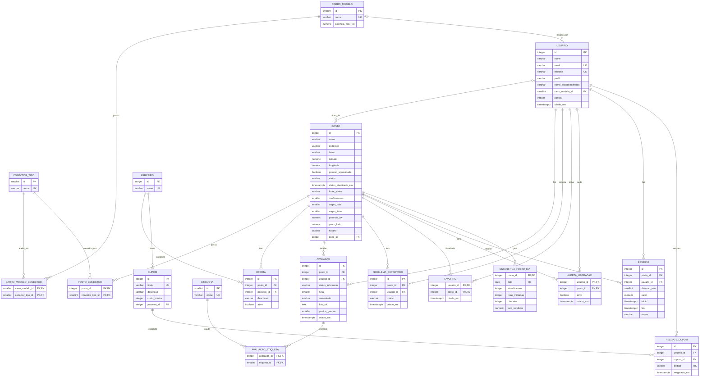

# Modelo Lógico do MAPERE

Tabelas, colunas, chaves primárias (PK) e estrangeiras (FK). Os nomes batem com o script `Tabelas/01_create_tables.sql`. O diagrama aparece desenhado direto no GitHub.

## Regras que viraram constraints

| Regra do produto | Constraint |
|---|---|
| Status só pode ser Livre, Ocupado ou Fora do ar | `ck_posto_status`, `ck_avaliacao_status` |
| Fonte do status: Usuários ou Operadora | `ck_posto_fonte` |
| Vagas livres nunca passam das vagas totais | `ck_posto_vagas` |
| Potência e preço podem ser desconhecidos ("a confirmar") | `potencia_kw` e `preco_kwh` aceitam `null` |
| Nota da avaliação vai de 1 a 5 | `ck_avaliacao_nota` |
| Reserva: 15 min = R$ 3, 30 min = R$ 5, 45 min = R$ 7 | `ck_reserva_duracao_valor` |
| Dono de posto precisa ter o nome do estabelecimento | `ck_usuario_dono_estab` |
| E-mail e telefone não se repetem | `uq_usuario_email`, `uq_usuario_tel` |
| Cada usuário resgata um cupom uma vez | `uq_resgate_usuario_cupom` |
| Não apagar plugue que está em uso | `on delete restrict` em `fk_pc_conector` |

## Normalização

Todas as tabelas estão na 3ª forma normal: valores atômicos, nenhuma coluna depende de parte de uma chave composta, e nenhuma coluna não-chave depende de outra não-chave. Dados que se repetem (plugues, parceiros, etiquetas) ficam em tabelas próprias.

> **Para entregar à professora:** refaça este diagrama no BRModelo (modelo lógico), tire o print e salve nesta pasta. O arquivo `.md` serve de guia.
